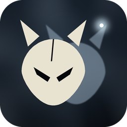
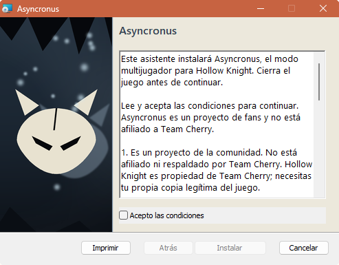
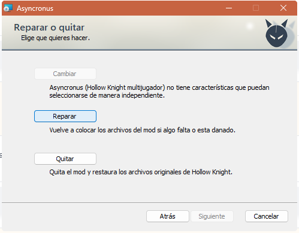
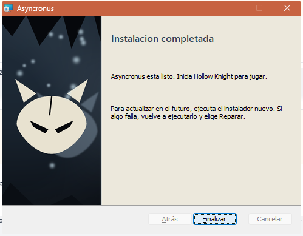
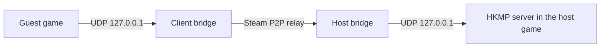

<div align="center">



# AHK — Asyncronus Hollow Knight

**Co-op for Hollow Knight with synced enemies, join-by-code over Steam and a one-click installer.**<br>
Built on [HKMP](https://github.com/Extremelyd1/HKMP) · Hollow Knight 1.5.12459 (Unity 6) · Windows and Linux (Proton).

[](https://github.com/Muurrcc/AHK-asyncronus-hollow-knight/actions/workflows/build.yml)




</div>

> Fan project. Not affiliated with or endorsed by Team Cherry. You need your own copy of Hollow Knight.

## Table of contents

- [Features](#features)
- [Preview](#preview)
- [Installation](#installation)
- [Uninstalling](#uninstalling)
- [Linux](#linux)
- [Playing](#playing)
- [How it works](#how-it-works)
- [Tech stack](#tech-stack)
- [Project layout](#project-layout)
- [Building from source](#building-from-source)
- [Troubleshooting](#troubleshooting)
- [Known limitations](#known-limitations)
- [Credits & license](#credits--license)

## Features

- **Synced enemies.** If one player hits or kills an enemy, the other sees it. Grubs are shared between players. Health, soul, equipped charms and tarros are per player; world progress (doors, dead enemies, defeated bosses) is shared.
- **Enemies chase the nearest player.** Enemies target and attack the closest player, host or not, and only switch targets when another player is clearly closer (hysteresis). Controlled by `EnemiesTargetNearestPlayer` (on by default).
- **Steam names above characters.** Your Steam name is shown over your character (option *Steam Name* in the mod menu, on by default). Spaces become `_` and names are capped at 20 characters.
- **Skin kept between sessions.** Your chosen skin is saved and applied automatically when you connect.
- **Enemy health scales with players.** Enemies get more health as players connect (`EnemyHealthPercentPerExtraPlayer`, default 50: x1.5 with two players; `0` disables it). It is implemented by dividing the damage they receive.
- **Join by code over Steam.** The host shares a short code (`XXXX-XXXX`); friends join through Steam's relay network. No port forwarding, no VPN. Optional password.
- **MSI installer that also updates.** Run a newer MSI over an old one to update. Uninstall from *Apps* or the Start menu; the original game files are restored.
- **Coexists with other mods.** It only adds `Managed\Mods\Asyncronus`; other mods and your saves are never touched.
- **No game files in this repository.** The installer applies a binary patch to *your* `Assembly-CSharp.dll` after verifying its hash.
- **Classic IP + port** (UDP 26950) is still available as a fallback.
- **Teleport.** A TP button in the pause menu and the `/tp [name]` command. Controlled by the server setting `AllowTeleport` (on by default). It uses the game's own respawn, so the screen and controls are always restored.
- **Arena and wave doors wait for everyone.** They only close once *all* players in the scene have entered (`ArenaWaitForAllPlayers`, on by default).
- **Rotating save backups.** Before applying the host's state, the mod keeps three rotating backups of each `user*.dat` (`user1.dat.hkmp-backup-*`), and all save writes are atomic.
- **Copy code button** for the join code.
- **Linux support.** Runs through Steam with Proton (recommended) or the native build. Not tested on real Linux yet; see [Linux](#linux).

## Preview

| Maintenance (repair / remove) | Finish |
|---|---|
|  |  |

The installer UI is currently in Spanish.

## Installation

1. Download `Asyncronus-<version>.msi` from [Releases](../../releases).
2. Close Hollow Knight and run the MSI. It does not need administrator rights.
3. Start the game from Steam. **Start Multiplayer** appears in the main menu.

Everyone who plays together must use the **same version**.

> **1.2.1 changes the network protocol compared with 1.1.x and 1.2.0.** Players on other versions cannot join each other. Update everyone to 1.2.1 together.

### Requirements

| | |
|---|---|
| OS | Windows 10 / 11, or Linux with Steam + Proton ([Linux](#linux)) |
| Game | Hollow Knight on Steam, build **1.5.12459** (Unity 6), no beta branch |
| Network | Steam running (for join-by-code) |

If the installer says your game is not the expected version: Steam → right-click Hollow Knight → Properties → Installed Files → *Verify integrity of game files*, and make sure Betas is set to *None*.

### Windows SmartScreen

The MSI is not code-signed (a signing certificate is a paid yearly item), so Windows may warn you: *More info → Run anyway*. All code is in this repository.

### Using Lumafly or other mods

This game version needs a different Modding API than the one Lumafly installs, so they are not compatible. The installer **never removes or moves your other mods**, but whether they work with the Unity 6 Modding API depends on each mod and has not been verified. Do not use Lumafly's *Install API* / *Update all* afterwards; it would overwrite this API.

## Uninstalling

Use **Uninstall Asyncronus** in the Start menu, or Settings → Apps. The original `Assembly-CSharp.dll` and the files the installer added are restored from `hollow_knight_Data\Managed-vanilla-backup`. Your saves and other mods are left alone. *Verify integrity of game files* in Steam also works.

## Linux

Asyncronus works on Linux through Steam with **Proton** (recommended: Proton 9+ or Experimental; Steam Deck included) or the native Linux build.

> **Status: not tested on a real Linux machine yet.** The installer was verified end to end on Windows (patch, hook generation, install, uninstall, byte-identical restore). Nothing has been run inside Hollow Knight on Linux. Version 1.2.1 fixes the Linux package: its scripts had Windows (CRLF) line endings and would not start, so run them with `bash`.

**Requirements:** Hollow Knight 1.5.12459 on Steam (*Betas: None*), Steam installed and logged in, a .NET 8+ runtime or SDK (only needed while installing), `bash`, `sha256sum` and `tar`.

**Install** (with the game closed, from the `Asyncronus-linux-X.Y.Z.tar.gz` release):

```bash
tar xzf Asyncronus-linux-*.tar.gz
cd Asyncronus-linux-*/
bash install.sh      # add --game-dir "/path/to/Hollow Knight" if it is not found
bash install.sh --verbose    # more detail in the install log
bash install.sh --diagnose   # print diagnostics for a bug report
```

The installer checks the hash of `Assembly-CSharp.dll` before changing anything. If it does not match the Windows build (for example, on the native Linux build), it stops and asks you to use Proton. It backs up the originals and reverts on failure.

**Launch:** start Hollow Knight from Steam as usual. No launch options are needed. **Start Multiplayer** should appear in the main menu.

**Host and join:** the same as on Windows, with Steam open and logged in on both sides and the same mod version.

**Uninstall:** `bash uninstall.sh` restores the original `Assembly-CSharp.dll` and removes the added files. It does not touch other mods or your saves.

**Troubleshooting:**
- *Game not found:* pass `--game-dir`. Flatpak Steam needs access to libraries outside your home.
- *.NET not found:* install .NET 8 or newer (on Steam Deck, use the user install in `~/.dotnet`).
- *Version mismatch:* verify integrity of game files and set Betas to *None*. On the native build, force Proton.
- *No Start Multiplayer:* check `ModLog.txt` for `Modding API: 0.0.0.0-77` and the Asyncronus mod.
- *Copy-code button does nothing:* Unity's clipboard needs X11 or XWayland. Type the code by hand.
- *Reporting a problem:* run `bash install.sh --diagnose` and send its output, the install log (`~/.local/state/asyncronus-install.log`) and your `ModLog.txt`.

Full guide (install options, file locations, error logs, technical notes): [docs/LINUX.md](docs/LINUX.md).

## Playing

1. **Host:** Start Multiplayer → *Start Hosting*. Your code is shown (and copied to the clipboard / printed in chat).
2. **Friends:** Start Multiplayer → type the code → *Join / Unirse* (and the password, if you set one).
3. Fallback: IP + port. A dedicated server (`HKMPServer`) can be built from `src/HKMPServer`.

Server rules (PvP, damage, names) live in the server settings; `FullSynchronisation` must stay `true` for enemy sync.

Server settings added in 1.2.0 and 1.2.1:
- `AllowTeleport` (default on): enables the TP button and `/tp [name]`.
- `EnemyHealthPercentPerExtraPlayer` (default 50, `0` disables): scales enemy health with connected players.
- `ArenaWaitForAllPlayers` (default on): arena and wave doors close only after every player in the scene has entered.
- `EnemiesTargetNearestPlayer` (default on): enemies chase and attack the nearest player, host or not.

## How it works



- **Steam bridge.** HKMP's protocol is unchanged. The host opens a Steam P2P listen socket and forwards each Steam connection to the local HKMP server through its own UDP socket (so HKMP sees one endpoint per player). The guest opens a local UDP port and forwards it over Steam to the host; HKMP connects to `127.0.0.1` without knowing. The code is the host's Steam account id plus a version and a check digit, as 8 readable characters (7 base32 + a check digit).
- **Installer.** The Unity 6 Modding API ([hk-modding/api PR #174](https://github.com/hk-modding/api/pull/174)) modifies `Assembly-CSharp.dll`. The MSI ships a bsdiff-style binary delta that turns the vanilla DLL into the patched one, generates the `MMHOOK_*` files locally with MonoMod HookGen, backs up what it overwrites and installs the mod to `Managed\Mods\Asyncronus`.
- **Enemy sync.** An extension of HKMP's entity system; unknown enemies are synced as generic entities. See [docs/DEVELOPMENT.md](docs/DEVELOPMENT.md).

## Tech stack

| | |
|---|---|
| Mod | C# (.NET Framework 4.7.2 / Unity 6), HKMP fork, Hollow Knight Modding API, Steamworks.NET (shipped with the game) |
| Networking | UDP + DTLS (BouncyCastle) locally, Steam Networking Sockets between players |
| Installer | WiX Toolset 6 (MSI), C# custom actions (WiX DTF, .NET Framework 4.8), MonoMod HookGen |
| Tests | xUnit (66 tests for the bridge, join code and relay) |

## Project layout

```
src/                 HKMP fork (mod + dedicated server) with enemy sync and the Steam bridge
  HKMP/Networking/SteamBridge/   Steam join-by-code bridge
installer/           MSI installer (WiX, helper, binary delta, theme assets)
tests/               Unit tests and a manual test harness for the bridge
docs/                Development notes, icon and screenshots
```

## Building from source

**Mod**

1. Copy `src/HKMP/LocalBuildProperties_example.props` to `LocalBuildProperties.props` (same for `src/HKMPServer`) and set `References` to a game `Managed` folder with the Unity 6 Modding API installed, and `OutputDirectory`.
2. `dotnet build src/HKMP.sln -c Release`

**Tests**

```
dotnet test tests/HKMP.SteamBridge.Tests
```

**Installer** — requires WiX 6 (`dotnet tool install --global wix --version 6.0.2`) plus the original `Assembly-CSharp.dll` and a compiled Modding API. See [installer/README.md](installer/README.md).

## Troubleshooting

- **No "Start Multiplayer" button:** check `%USERPROFILE%\AppData\LocalLow\Team Cherry\Hollow Knight\ModLog.txt`; it should say `Modding API: 0.0.0.0-77` and list the mod.
- **Cannot join with a code:** both players need Steam open and logged in, the same mod version, and the host must be in *Start Hosting*. Wrong password and full host are reported in the menu.
- **IP connection times out:** UDP gives no errors. Check firewall/router, or use the code instead.
- **Installer refuses to run:** the game must be closed and be build 1.5.12459 (see [Requirements](#requirements)).
- **Linux problems** (install, launch, host, uninstall): see the [Linux guide](docs/LINUX.md).

## Known limitations

- **Join by code between two different Steam accounts has not yet been verified in the real relay network.** The bridge is covered by unit tests and by Steam sockets locally and inside the game, but a real two-account test is still pending. Please open an issue with your `ModLog.txt` if it fails.
- Whole-game coverage is incomplete. Not verified: Godhome, Colosseum, PvP, level 2 spells, Sharp Shadow, Dung/Spore/Womb/Weaversong/Grimmchild/Dreamshield charms.
- Enemies with no saved state respawn when re-entering an empty room, as in the base game.
- Abilities and maps are per player (HKMP design).
- Banning by IP is not useful for bridged players: they all arrive from `127.0.0.1`. Ban by key instead.
- Teleport to bosses, arenas and Godhome has not been verified.
- Enemy targeting (`EnemiesTargetNearestPlayer`) does not cover bosses, arenas or homing projectiles, which can still go to the host.
- Waiting for all players before closing doors (`ArenaWaitForAllPlayers`) does not cover the Colosseum or bosses that start when hit.
- Linux support has not been tested on a real Linux machine. See [docs/LINUX.md](docs/LINUX.md#not-verified).

## Credits & license

- [HKMP](https://github.com/Extremelyd1/HKMP) by Extremelyd1, **LGPL-2.1** (`src/LICENSE`). This fork keeps that license; new code in `src/` is released under the same terms.
- [Hollow Knight Modding API](https://github.com/hk-modding/api) by the hk-modding team (MIT); Unity 6 port by leesiuuuu ([HK-Modding-API](https://github.com/leesiuuuu/HK-Modding-API)).
- Third-party components of the installer: see [installer/THIRD-PARTY-NOTICES.md](installer/THIRD-PARTY-NOTICES.md).
- Hollow Knight is © Team Cherry. This project contains none of its files.
